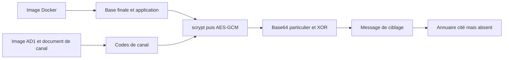

# The hunt

[Accueil](../../README.md) · [Forensics](../README.md) · [Index](../../INDEX.md)

## Informations générales

| Champ | Valeur |
|---|---|
| Nom | The hunt |
| Compétition | HackerLab Bénin 2026 |
| Catégorie de classement | Forensics |
| Difficulté | Non documentée |
| Points | 100 |
| Auteur | uchiwa |
| Statut | **Partial** |
| Technologies | Docker, SQLite, scrypt, AES-GCM, XOR, PCAP |
| Validation | Signalement local uniquement (reported) |

## 1. Introduction

Exploiter les artefacts Relay et une capture pour identifier le suspect.

Cette édition reconstruit les travaux conservés. Les commandes citées sont historiques, sauf mention explicite d’un contrôle documentaire local. Aucune cible n’a été contactée lors de la rédaction. Les paramètres d’accès et les réponses sont expurgés ; les remplacer depuis les artefacts autorisés pour une reproduction en laboratoire.

**Limites et corrections de cette édition.** Trois récits se contredisent : déchiffrement du chat puis annuaire, extraction d’une chaîne par strings, et exfiltration ICMP. Le script solve_the_hunt.py imprime une réponse constante après son décodage : cette ligne n’est pas une preuve. Le compte rendu générique de recherche de chaînes n’apporte pas de sortie indépendante et n’est pas retenu comme démonstration. L’annuaire externe cité n’est pas conservé. Aucun de ces récits n’est arbitrairement promu au rang de validation plateforme.

## 2. Énoncé du challenge

- L'un des binaire utilisé par le groupe de hackers a été identifié. Une analyse dynamique du binaire a été effectué pour comprendre son fonctionnement. Pouvez-vous fournir l'adresse mail du suspect ?

## 3. Analyse initiale

59 fichiers rattachés directement à ce dossier. Voir l’[inventaire des pièces](evidence/manifest.md), qui indique leur chemin d’origine, leur taille et la décision de publication. Les pièces partagées sont référencées dans les questions apparentées, sans recopier les archives.

**Contrôle local réellement effectué pendant cette édition :** [résultats structurés](evidence/controle-documentaire.json). Les mesures ne comportent aucune réponse ni secret.

## 4. Reconnaissance et investigation

Les notes détaillées décrivent l’extraction d’une image Docker exportée. Le contrôle documentaire actuel confirme un manifeste à onze couches, toutes présentes dans le dossier extrait. La capture `capture.pcap` est lisible par tshark et contient 230 paquets ; cela ne suffit pas à relier automatiquement cette capture au récit Docker.

Commandes historiques présentes dans les notes :

```bash
tar -xzf relay.tar.gz
cat manifest.json
sqlite3 data/relay.db "SELECT id, username FROM users;"
sqlite3 data/relay.db "SELECT id, name FROM channels;"
sqlite3 data/relay.db "SELECT count(*) FROM messages;"
```

La note rapporte trois canaux et 24 messages dans la base finale : 19 dans `general`, 5 dans `infra`, aucun dans `archive`. Les couches intermédiaires peuvent contenir d’autres états ; traiter l’image comme un répertoire plat ferait perdre l’ordre de remplacement des fichiers.

Sources : [note française détaillée](evidence/forensic-hunt-wu-md.txt) et [note de synthèse historique](evidence/forensic-hunt-writeup-the-hunt-md.txt).

## 5. Identification du mécanisme

L’image Docker contient plusieurs versions de la base ; lire la dernière couche utile est essentiel. Le stockage AES-GCM exige le bon AAD et le code de canal. L’algorithme client utilise un alphabet Base64 particulier puis un flux xorshift, qui est distinct de la protection du stockage.

## 6. Exploitation ou résolution

### Retrouver les codes de canal

La note relie les codes à `channel.pdf`, trouvé sur le poste de l’opérateur dans l’image AD1. Elle rapporte un passage par `pdf2john` et John avec un dictionnaire, puis la lecture du PDF. Les fichiers intermédiaires ne sont pas conservés sous ces noms dans le dossier extrait ; les codes et le mot de passe ne sont pas publiés.

### Déchiffrer le stockage

Le mécanisme décrit utilise scrypt avec `n=32768`, `r=8`, `p=1` et une sortie de 32 octets. Un `key_check` de canal vérifie la dérivation avant de traiter les messages. Le stockage AES-GCM utilise les 12 premiers octets comme nonce et lie le message à son canal et son auteur par l’AAD.

```python
key = hashlib.scrypt(code.encode(), salt=salt, n=2**15, r=8, p=1,
                     maxmem=64*1024*1024, dklen=32)
aad = f"relay:message:{channel_id}:{author}".encode()
```

Ces expressions proviennent des notes ; elles ne constituent pas un solveur autonome. Le succès doit être établi par la vérification du tag GCM avec le même AAD.

### Inverser le chiffrement client

Après la couche serveur, le contenu reste encodé par `cipher.exe`. Les notes décrivent un alphabet Base64 particulier, un sel de quatre octets, une graine dérivée par une variante de FNV-1a et un flux xorshift32, avec les décalages 13, 17 et 5. Le XOR inverse le flux ; le sel doit être retiré avant de reconstituer le texte.

### Relier le texte au suspect

Le récit détaillé cite un message visant un employé d’AquaTerv, puis un annuaire de l’univers du CTF pour obtenir son adresse. Cet annuaire n’est pas fourni dans les fichiers présents : le dernier pivot reste une assertion du compte rendu. Le signalement au hub ne remplace pas cette pièce manquante.



La variante ICMP est conservée comme piste concurrente. Elle trie les séquences, retire quatre octets de préfixe et applique un XOR répétitif. Sa ligne finale imprime une valeur fixe indépendante du résultat ; cette ligne ne valide pas le scénario.

## 7. Scripts et automatisation

Les copies sont expurgées et peuvent nécessiter la remise en place de paramètres ou d’artefacts. **Analyse syntaxique uniquement, sans exécution des solveurs ni de leurs opérations réseau.** Les imports listés ne constituent pas un environnement de dépendances testé. Les chemins relatifs historiques peuvent nécessiter une adaptation.

| Script | Source | Imports / dépendances | Contrôle | Nature |
|---|---|---|---|---|
| [forensic-hunt--solve_the_hunt.py](scripts/forensic-hunt--solve_the_hunt.py) | `forensic/hunt/solve_the_hunt.py` | argparse | syntaxe Python valide | traitement local apparent |
| [forensic-hunt--solveur.py](scripts/forensic-hunt--solveur.py) | `forensic/hunt/solveur.py` | argparse, collections, cryptography, pathlib | syntaxe Python valide | traitement local apparent |

## 8. Questions et flags

Les réponses ne sont pas publiées, conformément à la règle locale de non-divulgation. Un signalement au hub ne vaut pas acceptation par la compétition.

| Question / objectif | Méthode et preuve | Réponse | Validation |
|---|---|---|---|
| L'un des binaire utilisé par le groupe de hackers a été identifié. Une analyse dynamique du binaire a été effectué pour comprendre son fonctionnement. Pouvez-vous fournir l'adresse mail du suspect ? | Voir la reconstruction et les sources de ce dossier. | Non reproduite / inconnue si non résolue | Signalement local uniquement (reported) |

## 9. Difficultés rencontrées

Le compte rendu générique `ctf_writeup_relay_forensics.md` annonce une extraction immédiate par `strings` sans fournir de capture de commande indépendante. Il ne décrit pas les deux couches cryptographiques attestées par les autres notes. Cette version est conservée comme source contradictoire, pas utilisée comme démonstration.

La note détaillée écarte la recherche exhaustive des codes de canal, coûteuse avec scrypt et des codes non dictionnaires, ainsi que la récupération via la table `memberships` annoncée vide. L’absence de cette table utile ne prouve pas une faiblesse AES-GCM ; il faut les secrets de canal ou une autre preuve de compromission.

La chaîne documentaire demeure incomplète au pivot vers l’annuaire. Les trois récits ne peuvent pas être fusionnés en une résolution unique sans pièces supplémentaires.

## 10. Analyse technique approfondie

L’image Docker contient plusieurs versions de la base ; lire la dernière couche utile est essentiel. Le stockage AES-GCM exige le bon AAD et le code de canal. L’algorithme client utilise un alphabet Base64 particulier puis un flux xorshift, qui est distinct de la protection du stockage. Les critères de validation doivent porter sur les données produites, pas seulement sur l’absence d’erreur d’un outil.

## 11. Remédiations

Aucune recommandation spécifique supplémentaire n’est établie au-delà des limites du mécanisme décrit. Pour les exercices purement documentaires, la priorité est la conservation des originaux, la provenance des pièces et la séparation des hypothèses et des constats.

## 12. Conclusion

L’image et les scripts documentent une analyse en couches : système de fichiers Docker, chiffrement de stockage, encodage client, puis attribution contextuelle. La dernière étape et les variantes contradictoires empêchent de certifier une résolution plateforme. Le statut reste Partial.

## 13. Références

Les références sont les pièces locales ci-dessous. Les références Internet citées dans les notes restent historiques et n’ont pas été consultées pendant cette mission.

- [wu.md](evidence/forensic-hunt-wu-md.txt) — origine : `forensic/hunt/wu.md`.

- [writeup-The hunt.md](evidence/forensic-hunt-writeup-the-hunt-md.txt) — origine : `forensic/hunt/writeup-The hunt.md`.

- [ctf_writeup_relay_forensics.md](evidence/forensic-hunt-ctf-writeup-relay-forensics-md.txt) — origine : `forensic/hunt/ctf_writeup_relay_forensics.md`.

- [Inventaire local des pièces](evidence/manifest.md).
- [Retour à l’index](../../INDEX.md).

