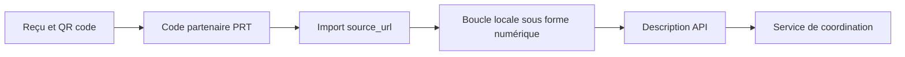

# THE GATE

[Accueil](../../README.md) · [Web](../README.md) · [Index](../../INDEX.md)

## Informations générales

| Champ | Valeur |
|---|---|
| Nom | THE GATE |
| Compétition | HackerLab Bénin 2026 |
| Catégorie de classement | Web |
| Difficulté | Non documentée |
| Points | 70 |
| Auteur | Non documenté |
| Statut | **Partial** |
| Technologies | HTTP, codes partenaires, SSRF, JSON |
| Validation | Signalement local uniquement (reported) |

## 1. Introduction

Atteindre le service interne de coordination Northline Transit.

Cette édition reconstruit les travaux conservés. Les commandes citées sont historiques, sauf mention explicite d’un contrôle documentaire local. Aucune cible n’a été contactée lors de la rédaction. Les paramètres d’accès et les réponses sont expurgés ; les remplacer depuis les artefacts autorisés pour une reproduction en laboratoire.

## 2. Énoncé du challenge

- Q1 — Objectif reconstitué de la note ; énoncé intégral de la carte absent.

## 3. Analyse initiale

4 fichiers rattachés directement à ce dossier. Voir l’[inventaire des pièces](evidence/manifest.md), qui indique leur chemin d’origine, leur taille et la décision de publication. Les pièces partagées sont référencées dans les questions apparentées, sans recopier les archives.

## 4. Reconnaissance et investigation

La note historique part du reçu fourni. La lecture du QR code livre une URL de suivi ; son code comporte trois segments : préfixe, identifiant et intégrité.

```bash
zbarimg --raw recu_northline.png
```

L’adresse du QR code vise un service interne distinct du portail public. La note rapporte ensuite que `/documentation` décrit un contrôle d’intégrité lié à l’identifiant. Remplacer `TRK` par `PRT`, sans modifier les deux autres segments, produit une session partenaire et une redirection HTTP 302. Les valeurs de session ont été retirées de cette édition.

```bash
curl -s -c /tmp/cj -o /dev/null -w '%{http_code}\n' \
  --data-urlencode 'code=PRT.<identifiant>.<integrite>' \
  http://<instance>:8080/login
```

La navigation authentifiée révèle `/dashboard`, `/shipments`, `/waybills` et `/partner-manual`. Le formulaire d’import des bordereaux accepte `source_url` et restitue le contenu récupéré dans un aperçu. C’est cette récupération par le serveur qui permet de franchir la séparation réseau ; la présence d’un code de session dans le tableau de bord correspond à une autre question.

Source : [note historique](evidence/web-depart-writeup-the-gate-md.txt).

## 5. Identification du mécanisme

Le segment d’intégrité n’est pas lié au préfixe TRK/PRT. Après accès au portail partenaire, l’import de bordereau permet une lecture du service local via une adresse IPv4 numérique. Les questions suivantes utilisent les relations expédition → opération → affectation ; seule l’affectation active est pertinente.

## 6. Exploitation ou résolution

### Atteindre le service local

Objectif : distinguer un refus du validateur d’une réponse du service interne. La note rapporte un refus immédiat pour les adresses littérales de boucle locale, mais une réponse distante 404 lorsque l’adresse est exprimée sous forme numérique.

```bash
curl -s -b /tmp/cj \
  --data-urlencode 'source_url=http://2130706433:8081/' \
  http://<instance>:8080/waybills
```

`2130706433` représente `127.0.0.1`. Le 404 ne signifie pas que le contournement a échoué : le serveur distant a répondu, mais aucune ressource n’est publiée à sa racine. La variante IPv4 mappée en IPv6 est également rapportée dans les notes.

### Lire la description de l’API

La route `/docs` fournit les relations nécessaires aux questions suivantes.

```bash
curl -s -b /tmp/cj \
  --data-urlencode 'source_url=http://2130706433:8081/docs' \
  http://<instance>:8080/waybills
```

La sortie historique décrit `Northline Dispatch Service`, version `2.3`, et les routes `/api/shipments/<reference>`, `/api/operations/<operation_id>`, `/api/operations/<operation_id>/assignments` et `/flag`.

### Vérifier la bonne ressource

```bash
curl -s -b /tmp/cj \
  --data-urlencode 'source_url=http://2130706433:8081/flag' \
  http://<instance>:8080/waybills
```

Le résultat rapporté comporte les champs `service=dispatch` et `status=ok`, avec une réponse non reproduite. Ces deux champs permettent de distinguer le service interne du tableau de bord partenaire. Le hub conserve un signalement, sans retour du système de notation.



Les paramètres d’instance et le code d’accès sont les seules substitutions éditoriales des commandes ci-dessus. Aucun de ces appels n’a été rejoué pendant la rédaction.

## 7. Scripts et automatisation

Les copies sont expurgées et peuvent nécessiter la remise en place de paramètres ou d’artefacts. **Analyse syntaxique uniquement, sans exécution des solveurs ni de leurs opérations réseau.** Les imports listés ne constituent pas un environnement de dépendances testé. Les chemins relatifs historiques peuvent nécessiter une adaptation.

| Script | Source | Imports / dépendances | Contrôle | Nature |
|---|---|---|---|---|
| [web-depart--solveur.py](scripts/web-depart--solveur.py) | `web/depart/solveur.py` | __future__, argparse, html, json, re, requests, shutil, subprocess, sys | syntaxe Python valide | réseau ou interaction de service |

## 8. Questions et flags

Les réponses ne sont pas publiées, conformément à la règle locale de non-divulgation. Un signalement au hub ne vaut pas acceptation par la compétition.

| Question / objectif | Méthode et preuve | Réponse | Validation |
|---|---|---|---|
| Q1 — Objectif reconstitué de la note ; énoncé intégral de la carte absent. | Voir la reconstruction et les sources de ce dossier. | Non reproduite / inconnue si non résolue | Signalement local uniquement (reported) |

## 9. Difficultés rencontrées

| Tentative historique | Observation rapportée | Interprétation limitée |
|---|---|---|
| Préfixe TRK au login | Refus du préfixe | Un code de suivi n’est pas accepté directement comme code partenaire. |
| Adresse interne du reçu sur le port 8182 | Refus immédiat | Le validateur bloque cette forme de requête. |
| `file:`, `gopher:`, `ftp:` | Refus | Ces schémas n’ont pas fourni la primitive recherchée. |
| `127.0.0.1:8081` et `localhost:8081` | Refus | Les représentations littérales sont bloquées. |
| Forme numérique sur le port 8081 | Réponse distante 404 | La requête atteint un service ; rechercher une route valide. |

Les différences de délai orientent l’hypothèse d’un filtre préalable, mais ne prouvent pas à elles seules son implémentation exacte. Aucun code serveur du filtre n’est conservé.

## 10. Analyse technique approfondie

Le segment d’intégrité n’est pas lié au préfixe TRK/PRT. Après accès au portail partenaire, l’import de bordereau permet une lecture du service local via une adresse IPv4 numérique. Les questions suivantes utilisent les relations expédition → opération → affectation ; seule l’affectation active est pertinente. Les critères de validation doivent porter sur les données produites, pas seulement sur l’absence d’erreur d’un outil.

## 11. Remédiations

Lier cryptographiquement le type de code à son identifiant ; appliquer une autorisation par opération et affectation. Normaliser et contrôler les adresses résolues avant toute requête serveur et isoler les services internes.

## 12. Conclusion

Atteindre le service interne de coordination Northline Transit. La documentation disponible permet une documentation partielle. Statut retenu : Partial. Signalement local uniquement (reported).

## 13. Références

Les références sont les pièces locales ci-dessous. Les références Internet citées dans les notes restent historiques et n’ont pas été consultées pendant cette mission.

- [writeup-THE-GATE.md](evidence/web-depart-writeup-the-gate-md.txt) — origine : `web/depart/writeup-THE-GATE.md`.

- [Inventaire local des pièces](evidence/manifest.md).
- [Retour à l’index](../../INDEX.md).

